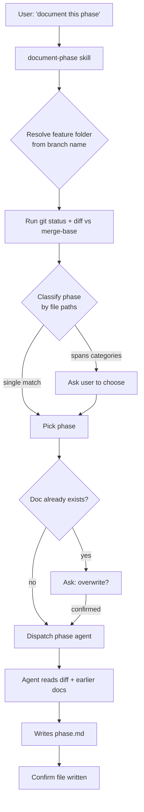
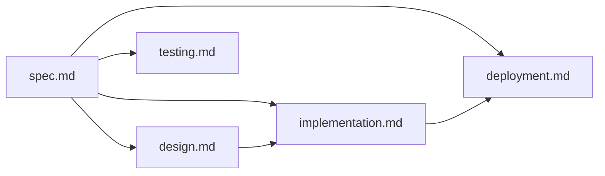

# feature-dev-documentalist

Auto-documenting your feature work, one phase at a time

<div class="pt-8 opacity-80 text-sm">
A beginner-friendly tour · strengths & weak points · a roadmap
</div>

<div class="abs-br m-6 text-xs opacity-60">
Plugin v0.1.3 · Claude Code plugin
</div>

<!--
This deck assumes no prior knowledge of Claude Code plugins.
We build up the vocabulary first, then walk the flow, then critique honestly.
-->

---
layout: statement
---

# The one-sentence pitch

<div class="text-2xl leading-relaxed pt-6">
"As you finish each phase of building a feature, it looks at your git changes and
<span class="text-teal-400">writes the docs for you</span> — a spec, a design, an implementation summary, deployment notes, and a testing guide."
</div>

---
layout: default
---

# Who is this deck for?

<v-clicks>

- 🧑‍💻 **Developers** curious whether to adopt this plugin
- 🏗️ **Plugin authors** who want to learn from its design
- 🔍 **Reviewers** weighing it against modern best practice

</v-clicks>

<div v-click class="mt-8 p-4 border-l-4 border-teal-400 bg-teal-400/10 rounded">

**We'll be honest.** This is not marketing. We celebrate what's clever and call out
what's fragile or behind the state of the art (SOTA) — with concrete fixes.

</div>

---
layout: section
---

# Part 1 — The vocabulary

Four Claude Code concepts you need first

---
layout: default
---

# The building blocks of a Claude Code plugin

A **plugin** bundles capabilities that extend Claude Code. This one uses four kinds:

<div class="grid grid-cols-2 gap-4 pt-4">

<div v-click class="p-4 border rounded">

### 🧩 Skill
A named workflow Claude can invoke. Think **"a recipe"** Claude follows.
<br><span class="text-xs opacity-70">Here: <code>document-phase</code></span>

</div>

<div v-click class="p-4 border rounded">

### 🤖 Agent
A **sub-Claude** with its own prompt, tools, and model. Runs a focused job and reports back.
<br><span class="text-xs opacity-70">Here: 5 phase documenters</span>

</div>

<div v-click class="p-4 border rounded">

### 🪝 Hook
A script that fires on an **event** (e.g. after every turn). No LLM — just code.
<br><span class="text-xs opacity-70">Here: <code>check-undocumented</code> on <code>Stop</code></span>

</div>

<div v-click class="p-4 border rounded">

### 📄 Manifest
<code>plugin.json</code> — name, version, description. The **ID card**.
<br><span class="text-xs opacity-70">Here: v0.1.3</span>

</div>

</div>

---
layout: two-cols
layoutClass: gap-8
---

# The problem it solves

Docs are the first thing to get skipped under deadline pressure.

<v-clicks>

- Why was it built this way? → *lost*
- What was rejected and why? → *lost*
- How do I deploy / roll back? → *tribal knowledge*
- How do I run the tests? → *ask around*

</v-clicks>

::right::

<div v-click>

# The bet

<div class="pt-4">

Your **git diff already contains most of the answer.**
Let an agent read it and draft the doc, so a human only has to *edit*, not *author from scratch*.

</div>

<div v-click class="mt-6 p-3 bg-amber-400/10 border-l-4 border-amber-400 rounded text-sm">

Hold onto this bet — we'll question how far a diff really gets you later. 🎯

</div>

</div>

---
layout: section
---

# Part 2 — How it works

Follow the flow, end to end

---
layout: default
---

# The five phases → five documents

Each phase produces one markdown file in a per-feature folder.

| Phase | Agent | File | Captures |
|---|---|---|---|
| 📋 Spec | `spec-documenter` | `spec.md` | Problem, user stories, acceptance criteria |
| 🏛️ Design | `architect-documenter` | `design.md` | Decisions, components, data flow, alternatives |
| 🔨 Implementation | `impl-documenter` | `implementation.md` | What was built, key files, patterns, tech debt |
| 🚀 Deployment | `deploy-documenter` | `deployment.md` | Env vars, infra, flags, migrations, rollback |
| ✅ Testing | `testing-documenter` | `testing.md` | Strategy, how to run, setup, coverage gaps |

<div v-click class="mt-4 text-sm opacity-80">

Output: <code>docs/features/2026-07-21-my-branch/</code> — generate only the phases relevant to you.

</div>

---
layout: default
---

# The flow when you say "document this phase"



---
layout: default
---

# Phase detection: first match wins

The skill classifies from **changed file paths**, top to bottom:

```text
*test*, *spec*, e2e/, *.test.*      → Integration Testing
helm/, k8s/, *docker*, *.env*,      → Deployment
  .github/workflows/, ci/, infra/
src/, lib/, app/, pkg/, internal/   → Implementation
docs/, *.drawio, *.puml, *adr*      → Design
(no code, only requirements)        → Spec
```

<div class="grid grid-cols-2 gap-6 pt-4">

<div v-click class="p-3 bg-green-400/10 border-l-4 border-green-400 rounded text-sm">

**Clever:** cheap, deterministic, no LLM call to route. Ambiguity → *ask the user* instead of guessing.

</div>

<div v-click class="p-3 bg-amber-400/10 border-l-4 border-amber-400 rounded text-sm">

**Still fragile:** one test file in a big branch flips the whole thing to "Testing." Multi-label detection is 🔜 planned (mid-term).

</div>

</div>

---
layout: default
---

# How the agents "coordinate"

There is **no live message-passing.** Coordination happens through **files on disk.**



<v-clicks>

- Each agent is told: *"read any existing phase docs in the feature folder first."*
- So later docs use earlier ones as **context** (impl reads spec + design).
- It's **asynchronous** — whatever happens to be written so far. No back-propagation.

</v-clicks>

---
layout: default
---

# The safety nudge: the Stop hook

A tiny bash script runs after **every** Claude turn. Pure logic, no LLM.

```bash
# check-undocumented (simplified, after the fix)
branch=$(git branch --show-current)
[[ "$branch" =~ ^(main|master|develop)$ ]] && exit 0   # skip base branches
[[ -z "$(git status --short)" ]] && exit 0              # skip if clean
phase=$(classify_from_changed_files)                    # e.g. "implementation"
file="${phase}.md"                                      # the expected doc
[[ -f "docs/features/*${branch}*/$file" ]] || nudge "$phase"
```

<div class="grid grid-cols-2 gap-6 pt-2">

<div v-click class="p-3 bg-green-400/10 border-l-4 border-green-400 rounded text-sm">

**Nice touches:** `async` (non-blocking), silent on detached HEAD, cross-platform polyglot `.cmd`/bash wrapper.

</div>

<div v-click class="p-3 bg-green-400/10 border-l-4 border-green-400 rounded text-sm">

**✅ Fixed blind spot:** it now classifies the current phase and nudges for the **specific missing doc** — so it keeps reminding even after the folder exists.

</div>

</div>

---
layout: default
---

# Anti-hallucination guardrails

Every agent prompt repeats the same discipline:

<div class="grid grid-cols-2 gap-6 pt-4">

<div v-click>

### The rule
> "Do not invent facts. Where you cannot infer something confidently, write `[to be confirmed]` rather than fabricating a plausible guess."

</div>

<div v-click>

### Why it matters
Documentation that *sounds* authoritative but is wrong is **worse than none** —
readers trust it. Forcing `[to be confirmed]` makes uncertainty visible.

</div>

</div>

<div v-click class="mt-6 p-3 bg-teal-400/10 border-l-4 border-teal-400 rounded text-sm">

This is genuinely good prompt hygiene and aligned with SOTA — surface uncertainty rather than smoothing over it. ✅

</div>

---
layout: section
---

# Part 3 — Strengths

What this plugin gets right

---
layout: default
---

# What it gets right

<div class="grid grid-cols-2 gap-4 pt-2">

<v-clicks>

<div class="p-3 border rounded">

**🎯 Single responsibility per agent**
One agent, one phase, one file, one template. Easy to reason about and extend.

</div>

<div class="p-3 border rounded">

**⚡ Low-friction routing**
Deterministic path-glob detection = no cost, no latency, predictable.

</div>

<div class="p-3 border rounded">

**📐 Consistent structure**
Fixed templates → every feature's docs look the same. Great for onboarding.

</div>

<div class="p-3 border rounded">

**🧱 Robust, simple state model**
Files on disk. No orchestration engine, no race conditions to debug.

</div>

<div class="p-3 border rounded">

**🌍 Cross-platform care**
Polyglot hook wrapper handles Windows/Git-Bash/Unix gracefully.

</div>

<div class="p-3 border rounded">

**🛑 Honest uncertainty**
`[to be confirmed]` over confident fabrication. Human-in-the-loop by design.

</div>

</v-clicks>

</div>

---
layout: section
---

# Part 4 — Weak points & SOTA gaps

The honest part 🔍 — and what we've since fixed

---
layout: default
---

# Status legend

Since this review, a feature branch shipped the four **near-term** fixes — plus living-doc **update mode**. Watch for these badges:

<div class="grid grid-cols-3 gap-4 pt-6">

<div class="p-4 border-l-4 border-green-400 bg-green-400/10 rounded">

### ✅ FIXED
Landed on the improvement branch. The critique no longer applies.

</div>

<div class="p-4 border-l-4 border-amber-400 bg-amber-400/10 rounded">

### 🔜 PLANNED
Agreed and scheduled (mid / long term). Not done yet.

</div>

<div class="p-4 border-l-4 border-red-400 bg-red-400/10 rounded">

### 🔴 OPEN
Still an unaddressed weakness.

</div>

</div>

<div v-click class="mt-8 p-3 bg-teal-400/10 border-l-4 border-teal-400 rounded text-sm">

See the companion deck — <code>changeset.md</code> — for a beginner-friendly walk-through of exactly what changed and why.

</div>

---
layout: default
---

# ✅ Critique #1 — Changeset scope <span class="text-green-400">— FIXED</span>

The skill *used to* detect phase from **`git diff HEAD`** (uncommitted changes only).

```bash
git status --short
git diff HEAD              # ← only working-tree vs last commit
git diff --staged          # ← fallback ONLY if HEAD has no parent
```

<v-clicks>

- On a feature branch you **commit as you go** — normal, healthy practice.
- By the time you document, your work is **committed** → `git diff HEAD` is **empty**.
- Result: detection under-fires or misclassifies; the doc misses committed work.

</v-clicks>

<div v-click class="mt-4 p-3 bg-green-400/10 border-l-4 border-green-400 rounded text-sm">

**✅ Fixed:** the skill and agents now resolve the branch base and diff against
<code>git merge-base</code> — <code>git diff --name-only "$base"</code> — capturing the *whole feature*, committed or not. Verified: a committed file that `git diff HEAD` missed now shows up.

</div>

---
layout: default
---

# ✅ Critique #2 — Diffs can't reveal the "why" <span class="text-green-400">— FIXED (mitigated)</span>

The plugin asked agents to infer **problem statements, user stories, and rejected alternatives** from code alone.

<div class="grid grid-cols-2 gap-6 pt-4">

<div v-click class="p-3 bg-red-400/10 border-l-4 border-red-400 rounded">

### The paradox
The things most worth documenting — *why* you chose X, *what* you rejected, *who* needs this — are precisely the things **not present in the diff**.

</div>

<div v-click class="p-3 bg-amber-400/10 border-l-4 border-amber-400 rounded">

### The risk
An LLM asked to "infer rejected alternatives" from code will **confabulate plausible ones.** `[to be confirmed]` helps, but the temptation to guess is structural.

</div>

</div>

<div v-click class="mt-6 p-3 bg-green-400/10 border-l-4 border-green-400 rounded text-sm">

**✅ Fixed:** spec & design agents now read **full commit-message bodies** and in-repo **ADR/design files**, with an explicit rule to *prefer stated intent over inference*. <span class="opacity-70">(Local-git sources for now; PR/issue ingestion remains 🔜 planned.)</span>

</div>

---
layout: default
---

# ✅ Critique #3 — Model choice for reasoning work <span class="text-green-400">— FIXED</span>

All five agents *were* pinned to **`model: haiku`**.

<v-clicks>

- Haiku is fast and cheap — great for **mechanical extraction** (list changed files, patterns).
- But spec & design docs need **inference about intent and trade-offs** — a reasoning task.
- Using the smallest model for the most judgment-heavy output is a **mismatch.**

</v-clicks>

<div v-click class="mt-6 p-3 bg-green-400/10 border-l-4 border-green-400 rounded text-sm">

**✅ Fixed:** `spec` & `design` now run on **Sonnet**; `impl`/`deploy`/`testing` stay on **haiku** for cheap extraction. Each agent's model is set in its frontmatter and documented in the README, so it's **configurable per agent**.

</div>

---
layout: default
---

# ✅ Critique #4 — Write-once docs drift <span class="text-green-400">— FIXED</span>

<v-clicks>

- Docs *used to be* generated as a **snapshot** — re-running **overwrote the whole file**, so any human edits were **lost**.
- There was no update mode: regeneration meant starting from a blank template every time.

</v-clicks>

<div v-click class="mt-6 grid grid-cols-2 gap-4 text-sm">

<div class="p-3 bg-green-400/10 border-l-4 border-green-400 rounded">

**✅ Fixed:** agents now run in **update mode** — they read the existing doc and make targeted `Edit`s, **preserving human-authored content** and refreshing only what changed.

</div>

<div class="p-3 bg-amber-400/10 border-l-4 border-amber-400 rounded">

**🔜 Still planned:** automatic **drift detection** — a hook that flags docs whose source files changed since generation. Merging is done; proactive staleness alerts are next.

</div>

</div>

---
layout: default
---

# 🟡 Smaller gaps worth noting

<div class="grid grid-cols-2 gap-4 pt-2 text-sm">

<v-clicks>

<div class="p-3 border rounded">

**Phase detection is single-label**
First-match-wins on globs. Real features are multi-phase → constant "ask the user" or misfire.

</div>

<div class="p-3 border rounded border-green-400/50 bg-green-400/5">

**✅ Hook coverage is folder-level** *(fixed)*
Now classifies the phase and tracks *per-phase* docs, nudging for the specific missing one.

</div>

<div class="p-3 border rounded">

**No self-verification pass**
Nothing re-reads the draft to flag low-confidence claims or leftover `[to be confirmed]`.

</div>

<div class="p-3 border rounded">

**No cross-feature index**
Each folder is an island — no changelog, no aggregated view, no discoverability.

</div>

<div class="p-3 border rounded">

**No tests for the plugin itself**
Detection rules & the hook are untested; regressions are silent.

</div>

<div class="p-3 border rounded">

**Date handling is model-trusted**
`YYYY-MM-DD` is filled by the LLM, not a reliable clock source.

</div>

</v-clicks>

</div>

---
layout: default
---

# Scorecard

| Dimension | Before | After the fix |
|---|---|---|
| Architecture clarity | 🟢 Strong | 🟢 Strong — clean, single-responsibility |
| Ease of adoption | 🟢 Strong | 🟢 Strong — natural-language triggers |
| Changeset correctness | 🔴 Weak | 🟢 **Fixed** — diffs vs merge-base |
| Content fidelity | 🟡 Mixed | 🟢 **Improved** — reads commit bodies + ADRs |
| Model fit | 🟡 Mixed | 🟢 **Fixed** — Sonnet for spec/design |
| Doc longevity | 🔴 Weak | 🟢 **Fixed** — update mode preserves edits |
| Guardrails / honesty | 🟢 Strong | 🟢 Strong — `[to be confirmed]` discipline |
| Cross-platform | 🟢 Strong | 🟢 Strong — polyglot hook wrapper |

---
layout: section
---

# Part 5 — Roadmap

Concrete, prioritized improvements

---
layout: default
---

# Roadmap — near term (highest ROI) <span class="text-green-400 text-2xl">— DONE ✅</span>

<v-clicks>

1. **Fix changeset scope** ✅
   Detection & agents now diff against `git merge-base`. Captures the whole feature.

2. **Ingest real intent sources** ✅
   Spec/design agents read commit bodies + in-repo ADRs. *(PR/issue ingestion still to come.)*

3. **Tier the models** ✅
   Sonnet for `spec`/`design`; haiku for extraction. Configurable per agent, documented in README.

4. **Per-phase hook coverage** ✅
   Hook classifies the phase and nudges on the *specific missing doc*.

</v-clicks>

<div v-click class="mt-6 p-3 bg-green-400/10 border-l-4 border-green-400 rounded text-sm">

All four shipped on the improvement branch. Details in the companion <code>changeset.md</code> deck. 🎉

</div>

---
layout: default
---

# Roadmap — mid term

<v-clicks>

5. **Living-doc update mode** ✅ *(done)*
   Incremental, edit-preserving regeneration. Merge, don't clobber.

6. **Drift detection** 🔜
   Hook flags docs whose source files changed since generation.

7. **Self-verification agent**
   A reviewer pass that flags unresolved `[to be confirmed]` and weak inferences before writing.

8. **Confidence-scored, multi-label detection**
   Replace first-match globs with a classifier that can say "60% impl, 40% testing."

</v-clicks>

---
layout: default
---

# Roadmap — long term

<v-clicks>

9. **Cross-feature aggregation**
   Auto-generated index + changelog across all feature folders. Discoverability.

10. **Ecosystem integration**
    Emit PR description drafts, release notes, and CHANGELOG entries from the same docs.

11. **Plugin test suite + CI**
    Golden-file tests for detection rules and the hook. Catch regressions.

12. **Feedback loop**
    Learn from human edits — which sections get rewritten most → improve those prompts.

</v-clicks>

<div v-click class="mt-6 p-3 bg-teal-400/10 border-l-4 border-teal-400 rounded text-sm">

Theme: move from **"snapshot from a diff"** → **"living docs from all available intent, kept honest and current."**

</div>

---
layout: statement
---

# The bottom line

<div class="text-xl leading-relaxed pt-4 text-left max-w-3xl mx-auto">

<v-clicks>

- A **well-architected, genuinely useful** plugin with clean separation and honest guardrails. ✅

- The **four highest-ROI weaknesses are now fixed**: correct changeset scope, real-intent ingestion, tiered models, and per-phase nudging. 🎉

- Living-doc **update mode** now lands on top of those four — regeneration preserves your edits. ✅

- What remains is **planned, not forgotten** — drift detection, multi-label detection, and cross-feature aggregation. 🔜

- **Adopt it today** for consistent scaffolding — still **edit the output**, but it now starts from a much stronger draft.

</v-clicks>

</div>

---
layout: center
class: text-center
---

# Thank you

Questions, critiques, and PRs welcome

<div class="pt-8 opacity-70 text-sm">

Run this deck locally: &nbsp; <code>npx slidev slides.md</code>

</div>

<div class="abs-br m-6 text-xs opacity-50">
feature-dev-documentalist v0.1.3
</div>
